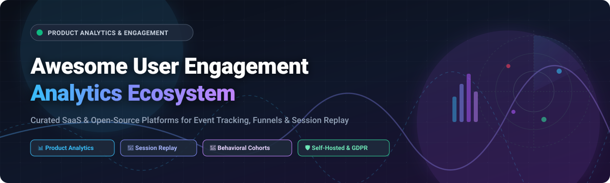
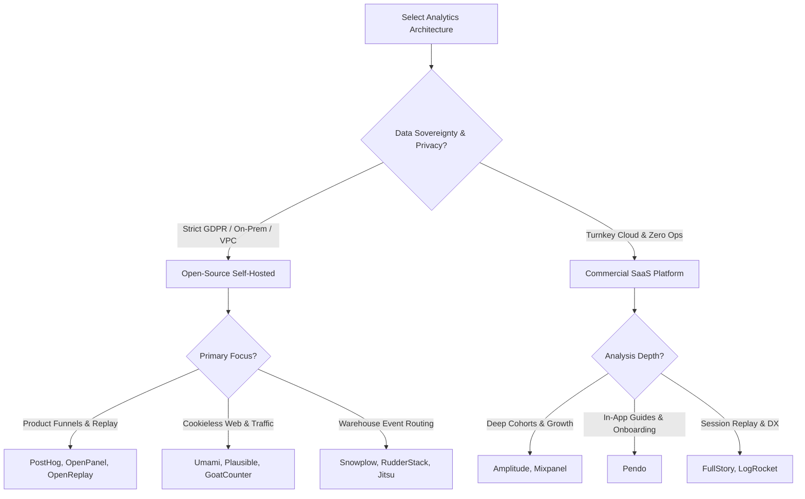

  

# Awesome User Engagement Analytics 📊🚀

  
  
  
  
  
  

---

## 🎯 Overview & Product Intelligence Ecosystem

Welcome to **Awesome User Engagement Analytics** — the definitive, SEO-optimized curated index of leading **SaaS platforms** and **open-source repositories** designed for **product analytics**, **behavioral event tracking**, **session replay**, **funnel conversion analysis**, and **user retention modeling**.

Whether you are an engineering team demanding zero-egress self-hosted telemetry (via ClickHouse, PostgreSQL, or single Go binaries), a product manager optimizing user activation cohorts, or a data team adhering to strict GDPR/HIPAA privacy compliance, this guide breaks down real pricing benchmarks, concrete free-tier allowances, company scale, and GitHub community traction.

---

## 📑 Table of Contents

- [🌐 Sector Overview & Market Dynamics](#-sector-overview--market-dynamics)
- [🏢 SaaS & Hosted Analytics Platforms](#-saas--hosted-analytics-platforms)
- [🔓 Open-Source GitHub Projects](#-open-source-github-projects)
- [🧩 Architectural Comparison & Selection Guide](#-architectural-comparison--selection-guide)
- [🤝 How to Contribute](#-how-to-contribute)
- [⚠️ Disclaimer](#️-disclaimer)
- [💖 Support & Community](#-support--community)
- [📈 Star History](#-star-history)

---

## 🌐 Sector Overview & Market Dynamics

- **Market Size & Rapid Expansion:** The global product analytics and customer engagement telemetry market was valued at **~$14.2 Billion in 2025** and is projected to expand to **$32.5+ Billion by 2030**, recording a compound annual growth rate (**CAGR of ~18.5%**). Adoption is aggressively accelerated by Product-Led Growth (PLG) operating motions, AI-driven behavioral path predictions, and universal demand for real-time digital customer experience (DX) observability.
- **Market Dynamics & Fragmentation:** The sector displays **moderate fragmentation with strong specialized differentiation rather than a monolithic winner-take-all outcome**. While legacy behemoths like Google Analytics capture wide-net top-of-funnel web attribution, deep in-app product intelligence (cohort retention, feature usage, user journey branches) is contested among specialized leaders like Amplitude, Mixpanel, Pendo, and Contentsquare/Heap. Simultaneously, privacy regulations (GDPR, CCPA, Schrems II) and escalating cloud per-event billing have sparked a massive wave toward **self-hosted, open-source architectures** (PostHog, Umami, Plausible, OpenReplay), ensuring that control over raw behavioral data remains decentralized.

---

## 🏢 SaaS & Hosted Analytics Platforms

The table below catalogs premier commercial SaaS product analytics platforms, sorted **in descending order by company scale (market capitalization or valuation)**. Starting tier prices and free-tier boundaries are explicitly documented:

| SaaS Platform | Company Scale (Valuation / Revenue) 🏢 | Starting Paid Tier Pricing 💳 | Free Tier Limits (Forever Plan or Trial) 🎁 | Core Focus & Best For 🎯 |
| :--- | :--- | :--- | :--- | :--- |
| **[Google Analytics 4](https://analytics.google.com/)** | **~$2.1 Trillion Market Cap** (Parent: Alphabet Inc. / $350B+ Rev) | **$50,000 / year** ($4,166 / mo for GA360 enterprise tier) | **Free forever plan** with up to 10M events/month, 14-month data retention for user/event data, and BigQuery daily export up to 1M events. | Ubiquitous web & app traffic measurement, campaign attribution, and BigQuery data pipeline integration. |
| **[Contentsquare / Heap](https://contentsquare.com/)** | **$5.6 Billion Valuation** (Series F / ~$300M+ ARR; acquired Heap) | **$3,600 / year** ($300 / mo billed annually for Heap Growth) | **Free forever plan** with up to 10,000 monthly sessions, 6 months data history, 1 project, and 2 user seats. | Complete digital experience analytics featuring retroactive autocapture, journey maps, and visual heatmaps. |
| **[Pendo](https://www.pendo.io/)** | **$2.6 Billion Valuation** (Series F / ~$150M+ ARR) | **$7,000 / year** (~$583 / mo billed annually for Base/Starter plan) | **Free forever plan** capped at 500 Monthly Active Users (MAUs), 1 year historical data, and core in-app guides. | Product analytics combined with interactive in-app onboarding guides, user feedback, and NPS surveys. |
| **[FullStory](https://www.fullstory.com/)** | **$1.8 Billion Valuation** (Series D / ~$100M+ ARR) | **$299 / month** (or ~$3,000 / yr base self-serve Business tier) | **Free forever plan (FullstoryFree)** with up to 30,000 sessions/month, 10 user seats, and 12-month retention; plus 14-day trial. | High-fidelity session replay, behavioral DX indexing, rage-click detection, and customer frustration analytics. |
| **[Amplitude](https://amplitude.com/)** | **~$1.2 Billion Market Cap** (NASDAQ: AMPL / ~$290M+ Rev) | **$49 / month** (billed annually for Plus tier; scales with event volume) | **Free forever Starter plan** with up to 2,000,000 events/month, unlimited seats, 10k session replays, and core cohorts. | Deep behavioral analysis, multi-step conversion funnels, churn modeling, and statistical A/B experimentation. |
| **[Mixpanel](https://mixpanel.com/)** | **$1.05 Billion Valuation** (Series C / ~$100M+ ARR) | **$100 / month** (billed annually, or $140/mo monthly beyond 1M events) | **Free forever plan** with up to 1,000,000 events/month, unlimited team seats, and 10k monthly session replays. | Intuitive self-serve product event exploration, interactive funnel breakdown, and user retention curves. |
| **[LogRocket](https://logrocket.com/)** | **~$200 Million Valuation** (Series C / ~$30M+ ARR) | **$69 / month** (billed annually for Team plan; 10,000 sessions/mo) | **Free forever plan** with up to 1,000 sessions/month, 1-month retention, 3 team members, and basic error tracking. | Developer-first session replay paired with frontend DOM reproduction, network telemetry, and error logging. |
| **[Kissmetrics](https://kissmetrics.io/)** | **~$30 Million Valuation** (~$12M Annual Revenue) | **$99 / month** (billed monthly for Growth plan; small-team entry at $25.49/mo) | **Free forever Workspace plan** with up to 100,000 events/month, 3 user seats, autocapture, and core funnel reports. | People-centric and revenue-attributed product analytics tying user behaviors directly to Customer LTV and churn. |

---

## 🔓 Open-Source GitHub Projects

Explore the finest self-hostable, privacy-preserving, and extensible open-source user engagement analytics projects. Repositories are sorted **in descending order by GitHub Stars_Counts**:

### 1. [PostHog](https://github.com/PostHog/posthog)  🦔
- **Description:** The undisputed heavyweight of open-source product analytics. PostHog unites product analytics, session replay, feature flags, multivariate experiments, user surveys, and error tracking into a single unified event database.
- **Architecture / Tech Stack:** Python (Django), TypeScript (React), ClickHouse, Kafka, PostgreSQL, Redis.
- **License:** MIT (Core) / PolyForm Shield.
- **Best For:** Engineering-driven teams that want an end-to-end, single-pane product intelligence platform hosted on their own VPC or bare-metal clusters.

### 2. [Umami](https://github.com/umami-software/umami)  🍙
- **Description:** A simple, fast, privacy-focused alternative to Google Analytics. Tracks pageviews, custom events, device metrics, and referral funnels without cookies or personal identifiable information (PII).
- **Architecture / Tech Stack:** Next.js, Node.js, Prisma, PostgreSQL / MySQL.
- **License:** MIT.
- **Best For:** Developers and modern web applications seeking clean dashboards, GDPR compliance out of the box, and zero tracking cookie consent banners.

### 3. [Plausible Analytics](https://github.com/plausible/analytics)  🌿
- **Description:** Lightweight, open-source web and engagement analytics. Its script is under 1 KB (>45x smaller than Google Analytics), fully cookieless, and compliant with GDPR, CCPA, and PECR without compromise.
- **Architecture / Tech Stack:** Elixir (Phoenix), ClickHouse, PostgreSQL.
- **License:** AGPL-3.0.
- **Best For:** Privacy-first SaaS teams and content creators who need fast, zero-bloat traffic attribution and goal conversion metrics.

### 4. [Matomo](https://github.com/matomo-org/matomo)  🛡️
- **Description:** The enterprise-grade open-source analytics platform deployed on over 1.4 million sites. Delivers 100% data ownership with deep heatmaps, session recording, custom reports, and compliance tools.
- **Architecture / Tech Stack:** PHP, MySQL / MariaDB, Vue.js.
- **License:** GPL-3.0.
- **Best For:** Regulated industries, healthcare, public sector, and European enterprises where strict data sovereignty and local on-premises hosting are non-negotiable.

### 5. [rrweb](https://github.com/rrweb-io/rrweb)  📼
- **Description:** The open-source standard library for recording and replaying user interactions on the web. It serves as the foundational session recording engine powering PostHog, OpenReplay, Highlight, and dozens of modern DX tools.
- **Architecture / Tech Stack:** TypeScript, MutationObserver DOM serialization, Canvas capture.
- **License:** MIT.
- **Best For:** Engineers building bespoke session replay engines, user experience recorders, and retrospective in-browser debugging tools.

### 6. [OpenReplay](https://github.com/openreplay/openreplay)  🔍
- **Description:** Self-hosted session replay and UX observability suite. Records user clicks, mouse movements, network payloads, Redux/Vuex state transitions, and console logs with enterprise privacy masking.
- **Architecture / Tech Stack:** Go, TypeScript, ClickHouse, Kafka, Redis, Docker/K8s.
- **License:** Fairwinds / Elv.
- **Best For:** Support and product teams diagnosing elusive customer-facing frontend bugs and analyzing exact user interaction pathways.

### 7. [Highlight.io](https://github.com/highlight/highlight)  💡
- **Description:** The open-source full-stack monitoring and engagement platform. Delivers session replay, error tracking, and distributed logging integrated with user telemetry.
- **Architecture / Tech Stack:** Go, React, ClickHouse, OpenTelemetry.
- **License:** Apache-2.0.
- **Best For:** Full-stack developers wanting seamless correlation between backend server errors and frontend user session replays.

### 8. [OpenPanel](https://github.com/Openpanel-dev/openpanel)  ⚡
- **Description:** The open-source Mixpanel alternative with built-in session replay and Model Context Protocol (MCP) server integration. Features funnels, cohorts, real-time dashboards, and A/B testing with cookieless tracking.
- **Architecture / Tech Stack:** Next.js, Fastify, ClickHouse, PostgreSQL, Redis, Docker.
- **License:** AGPL-3.0.
- **Best For:** Modern SaaS teams seeking a Mixpanel-style user interface paired with self-hosted ClickHouse performance and AI agent query support.

### 9. [Snowplow](https://github.com/snowplow/snowplow)  ❄️
- **Description:** Enterprise behavioral data engine. Collects, enriches, and structures real-time customer event streams across web, mobile, server, and IoT devices directly into your own data warehouse.
- **Architecture / Tech Stack:** Scala, Apache Spark, Kafka, Snowflake, BigQuery, AWS/GCP.
- **License:** Snowplow Limited Use License / Apache-2.0.
- **Best For:** Advanced data engineering teams requiring strict behavioral data governance and warehouse-native behavioral tracking.

### 10. [GoatCounter](https://github.com/arp242/goatcounter)  🐐
- **Description:** Ultra-fast, privacy-oriented web analytics that can be operated as a single Go binary or hosted service. Collects non-intrusive traffic stats without collecting personal identifying data.
- **Architecture / Tech Stack:** Go, SQLite / PostgreSQL, Vanilla JavaScript.
- **License:** EUPL-1.2.
- **Best For:** Minimalists, developers, and personal blogs wanting zero configuration, effortless single-file deployment, and total visitor privacy.

### 11. [Countly](https://github.com/Countly/countly-server)  📱
- **Description:** Mobile and web product analytics platform featuring crash reporting, push notifications, user profiles, and feature flag management.
- **Architecture / Tech Stack:** Node.js, MongoDB, Linux.
- **License:** AGPL-3.0 (Community Edition).
- **Best For:** Mobile app product managers and multi-platform development teams requiring built-in push notification campaigns and crash telemetry.

### 12. [Jitsu](https://github.com/jitsucom/jitsu)  🌊
- **Description:** Open-source Segment alternative and event collection platform. Ingests user interaction events, validates payloads against schemas, and replicates them to modern warehouses and marketing tools.
- **Architecture / Tech Stack:** TypeScript, Go, ClickHouse, Redis, Kafka.
- **License:** MIT.
- **Best For:** Engineering teams looking to replace proprietary customer data platforms (CDP) with open-source event routing pipelines.

### 13. [Ackee](https://github.com/electerious/Ackee)  🫐
- **Description:** Self-hosted Node.js-based analytics that respects user privacy. Features an eye-catching minimal dashboard and a lightweight GraphQL API for tracking referrers, duration, and user interactions.
- **Architecture / Tech Stack:** Node.js, MongoDB, GraphQL, Apollo Client.
- **License:** MIT.
- **Best For:** Node.js developers seeking an aesthetically refined, self-hosted web analytics dashboard.

### 14. [RudderStack](https://github.com/rudderlabs/rudder-server)  🧭
- **Description:** Enterprise Customer Data Platform (CDP) core server. Captures event streams from client SDKs, transforms events in flight, and routes them to over 180 product analytics and cloud storage destinations.
- **Architecture / Tech Stack:** Go, PostgreSQL, Redis.
- **License:** SSPL.
- **Best For:** Companies needing secure, warehouse-first customer event synchronization across Segment-compatible SDKs.

### 15. [Shynet](https://github.com/milesmcc/shynet)  🤫
- **Description:** Modern, privacy-respecting web analytics tool that works without cookies or JavaScript (via transparent tracking pixels) or with an optional light script.
- **Architecture / Tech Stack:** Python (Django), PostgreSQL, Nginx.
- **License:** Apache-2.0.
- **Best For:** Jamstack websites, static sites, and privacy-focused portals wanting cookieless analytics with zero client CPU overhead.

### 16. [Aptabase](https://github.com/aptabase/aptabase)  📲
- **Description:** Open-source, privacy-first mobile, desktop, and web app analytics. Built specifically for client-side applications (Flutter, React Native, Swift, Electron) with no IP storage.
- **Architecture / Tech Stack:** Rust, PostgreSQL / SQLite.
- **License:** AGPL-3.0.
- **Best For:** Native mobile and desktop developers who need lightweight, privacy-compliant session and crash tracking.

### 17. [Swetrix](https://github.com/Swetrix/swetrix)  📊
- **Description:** Fully open-source web and user analytics with built-in performance monitoring, custom event tagging, alerts, and chatbot tracking.
- **Architecture / Tech Stack:** TypeScript, Node.js, ClickHouse, Redis.
- **License:** AGPL-3.0.
- **Best For:** Teams wanting cookie-free web metrics combined with uptime and frontend performance monitoring.

### 18. [Medama](https://github.com/medama-io/medama)  👁️
- **Description:** Extremely fast, privacy-focused website analytics service written in Go and DuckDB. Designed to process millions of requests on tiny single-core virtual servers.
- **Architecture / Tech Stack:** Go, DuckDB, modern Web standards.
- **License:** Apache-2.0.
- **Best For:** High-efficiency hosting on minimal VPS hardware with sub-millisecond query responses.

### 19. [OpenAnalytics](https://github.com/OpenLabs-so/openanalytics)  📡
- **Description:** Lightweight self-hosted analytics engine with PostgreSQL storage and `tracker.js` for crafting bespoke real-time reporting dashboards.
- **Architecture / Tech Stack:** Node.js, PostgreSQL, JavaScript tracker.
- **License:** MIT.
- **Best For:** Builders who want a simple event ingestion backend and wish to code custom UI dashboards directly on SQL.

### 20. [smolanalytics](https://github.com/Arjun0606/smolanalytics)  🧪
- **Description:** Single-binary analytics toolkit with native Model Context Protocol (MCP) server support. Features funnels, cohorts, heatmaps, and in-product surveys with zero external database dependencies.
- **Architecture / Tech Stack:** Go single binary, embedded file storage, MCP tools.
- **License:** MIT.
- **Best For:** Developers using AI coding agents (Claude, Cursor, Copilot) who want their agents to query real product telemetry straight from their code editor.

---

## 🧩 Architectural Comparison & Selection Guide

When selecting between commercial SaaS and open-source infrastructure for user engagement analytics, evaluate these three primary trade-offs:

1. **Analytical Depth vs. Web Attribution:** Tools like **Amplitude** and **Mixpanel** (SaaS) and **PostHog** and **OpenPanel** (Open-Source) excel at complex multi-step funnels, behavioral cohorts, and user path drop-offs. In contrast, **Google Analytics 4**, **Umami**, and **Plausible** specialize in pageview acquisition, campaign UTMs, and referral sources.
2. **Database Engine (ClickHouse vs. PostgreSQL / MySQL):** High-volume event telemetry necessitates columnar storage. For large-scale production (>10M events/month), choose ClickHouse-backed engines (**PostHog**, **OpenPanel**, **Plausible**, **OpenReplay**). For lightweight setups (<1M events/month), relational databases (**Umami**, **Ackee**, **GoatCounter**) offer simpler operations and backups.
3. **Session Replay Storage Overhead:** Video-like DOM serialization (via **rrweb**) provides invaluable qualitative insight into user friction, but storage requirements grow swiftly. Ensure retention policies and local S3-compatible object storage (e.g., MinIO) are configured appropriately.

---

## 🤝 How to Contribute

Contributions from the developer and product community are warmly welcomed! To contribute:

1. 🍴 **Fork the Repository:** Click the Fork button at the top right of this page.
2. 🌿 **Create a Branch:** `git checkout -b feature/add-new-analytics-tool`
3. ✏️ **Add / Update Entry:** Maintain the existing table or list formatting, ensure factual accuracy, link to official sites/repos, and adhere to standard badges.
4. 🚀 **Submit a Pull Request:** Open a PR against `main` with a concise summary of the addition or correction.

Check out our curated umbrella list at [Awesome-Awesome-Awesome](https://github.com/ishandutta2007/Awesome-Awesome-Awesome)!

---

## ⚠️ Disclaimer

- This repository is a community-maintained curated educational index — listings do not constitute commercial endorsement or formal partnership.
- Product pricing, tier limits, and feature sets are actively updated as of 2026; however, vendor offerings may adjust over time. Always verify current commercial pricing on respective provider websites.
- Self-hosted open-source software provides full data sovereignty, but operational maintenance, server costs, backup protocols, and network security remain the deployer's responsibility.

---

## 💖 Support & Community

If this repository assisted you in discovering the right user engagement analytics or session replay tool for your project:

- 🌟 **Star this repository** to show appreciation and boost visibility on GitHub!
- 🍴 **Fork and share** with fellow developers, product managers, and data engineers.
- ☕ **Support Ongoing Maintenance:** Fuel continuous curation and updates by sponsoring or buying a coffee via the [GitHub Sponsor Dashboard](https://github.com/sponsors/ishandutta2007).

Thank you for being part of the open product intelligence community! 🚀

---

## 📈 Star History

---

  <b>Awesome User Engagement Analytics</b> is maintained with ❤️ by <a href="https://github.com/ishandutta2007">Ishan Dutta</a> and amazing contributors.

